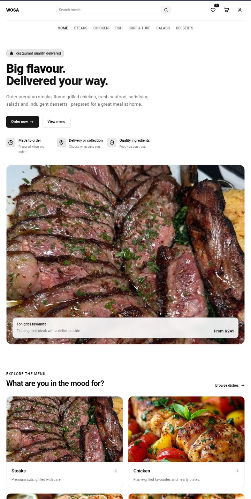
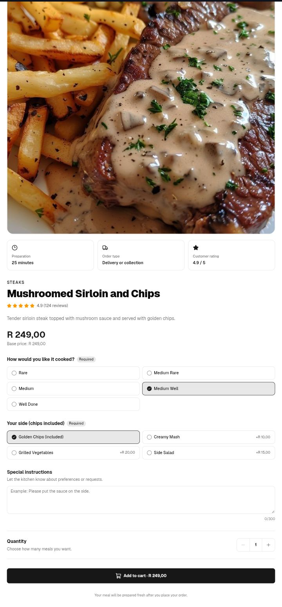
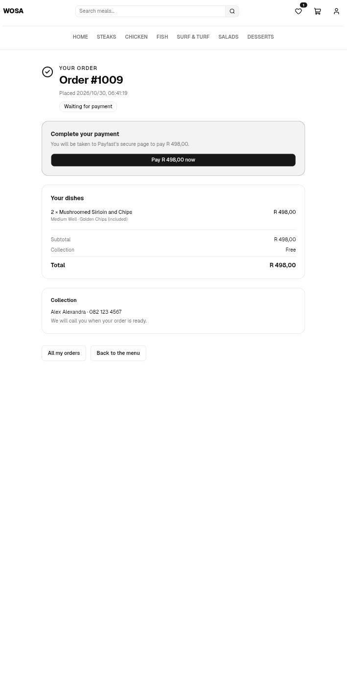
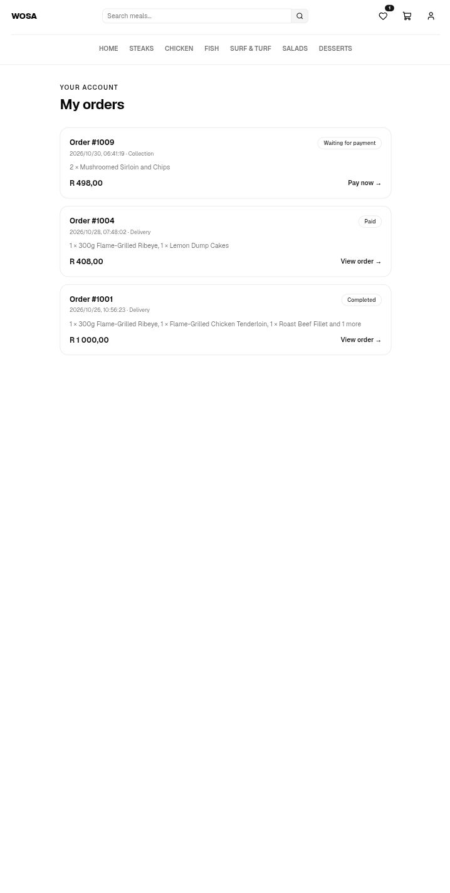
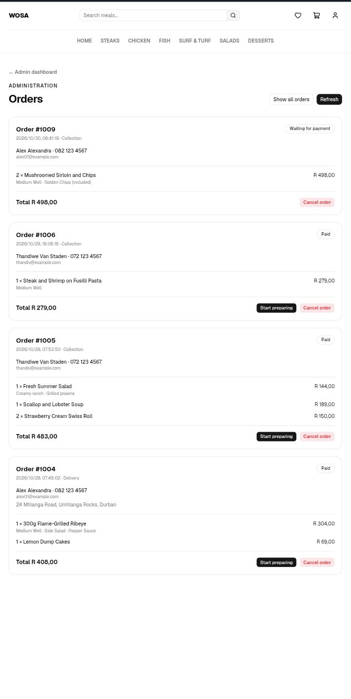

# Wosa

Wosa (Zulu for "grill") is a full-stack food ordering and delivery app. Customers browse a menu, customise dishes, order for delivery or collection, and a restaurant admin moves each order through its stages.

I built it as a portfolio project to practise the parts of web development that matter most in real products: authentication, data modelling, and never trusting the browser.

## Screenshots

<p>
  
  
  
  
  
</p>

## Features

- **Menu** across six categories (steaks, chicken, fish and seafood, surf and turf, salads, desserts)
- **Search** by dish name or description
- **Per-dish options** such as doneness, sides, sauces, dressings and spice level, stored in the database so each dish only offers what makes sense for it
- **Cart** that remembers its contents between visits
- **Wishlist** saved per account, so it follows the customer and never leaks between users
- **Accounts** with sign-up, sign-in and sign-out using secure server-side sessions
- **Checkout** for delivery (with a delivery fee) or collection
- **Orders** with a confirmation page, a "My orders" list and a Pay now button (Payfast sandbox)
- **Admin dashboard** that lists incoming orders and moves paid orders through preparing, out for delivery or ready for collection, and completed

## Tech stack

| Part | Tools |
|---|---|
| Frontend | React 19, React Router (framework mode), TypeScript, Zustand, Tailwind CSS, shadcn/ui, Sonner |
| Backend | Node.js, Express 5, express-session, Joi, bcryptjs, helmet |
| Database | PostgreSQL (`pg`), SQL migrations |
| Payments | Payfast sandbox (signed checkout, verified notifications) |

## Design decisions

**The server decides prices.** The browser sends dish IDs, quantities and option choices, never prices. The server looks everything up in the database, checks that every required option was chosen and that each choice really belongs to that dish, and works out the totals itself. Prices that arrive in a request are discarded by validation.

**Options are data, not code.** Option groups (like "Doneness") are written once and attached to dishes through a junction table. Adding a category or changing what a dish offers is a database change, not a code change.

**Orders are receipts.** Each order line copies the dish name, price and chosen options at the time of purchase, so changing the menu later never alters an old order. Order and item totals are also checked by database constraints.

**Sessions, not tokens in the browser.** The browser only holds an HttpOnly session cookie. The user's role is looked up in the database on every request, so it can't be edited. Admin routes sit behind both an authentication check and a role check on the server.

**Status changes are enforced on the server.** An order can only move along its allowed path (for example, it can't jump from "waiting for payment" to "completed"), and an update only applies if the order is still in the status the admin saw, which protects against two people editing at once.

**Reproducible database.** Everything is built from numbered migrations. A fresh database ends up identical to the development one (checked by building a scratch copy and comparing counts).

## Running it locally

You need Node.js 20 or newer and PostgreSQL.

```bash
git clone https://github.com/BlaqueC88/Wosa.git wosa
cd wosa

# 1. Database
createdb wosa

# 2. Server
cd server
cp .env.example .env      # fill in your database details and a long SESSION_SECRET
npm install
npm run migrate           # creates all tables and loads the menu
npm run dev               # http://localhost:5000

# 3. Client (in a second terminal)
cd ../client
cp .env.example .env
npm install
npm run dev               # http://localhost:5173
```

To make an account an admin, register it on the site first, then run:

```bash
cd server
node db/make-admin.js you@example.com
```

Type-check the client with `npm run typecheck`.

## Project structure

```
client/app/routes/       pages (category, dish, cart, checkout, orders, admin)
client/app/store/        Zustand stores (auth, cart, wishlist)
client/app/lib/          API calls, shared types and helpers
server/controllers/      request handlers
server/routes/           URL to handler wiring
server/validators/       Joi schemas
server/middleware/       authentication, roles, body validation
server/db/migrations/    numbered SQL migrations
```

## Payments (Payfast sandbox)

Customers pay through Payfast. The server builds a signed payment form for the customer's own unpaid order and sends them to Payfast. Payfast then notifies the server, and only a verified notification can mark an order as paid. Admins cannot mark an order paid by hand.

The notification handler checks the signature (made with a secret passphrase), the merchant, and that the amount matches the order, and it asks Payfast to confirm the notification. Receiving the same notification twice is safe.

**What was tested.** Against the real Payfast sandbox, the signed checkout was accepted and a test payment completed, and Payfast's notification reached the server through a public tunnel and passed the signature and merchant checks. The rest of the handler (marking the order paid, safe repeats, rejecting forged or tampered notifications) is covered by a simulator that sends correctly signed fake notifications: `node db/simulate-payfast-itn.js latest` (add `--bad-signature` or `--tamper-amount` to watch forged ones get rejected).

**Before going live:** a verified Payfast merchant account, a deployed server with a public HTTPS address, and a check of notification sender addresses against Payfast's current published list. That sender check is switched off in the sandbox because the sandbox notification came from an address my lookup did not list. The server refuses to start in production with it off.

## Not done yet

- Editing menu items from the admin dashboard
- Guest checkout
- Rate limiting on the sign-in routes
- Automated tests
- Live deployment

## Author

Built by Sibusiso Gabela, a self-taught web developer based in South Africa.